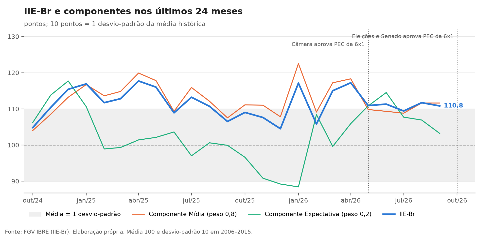
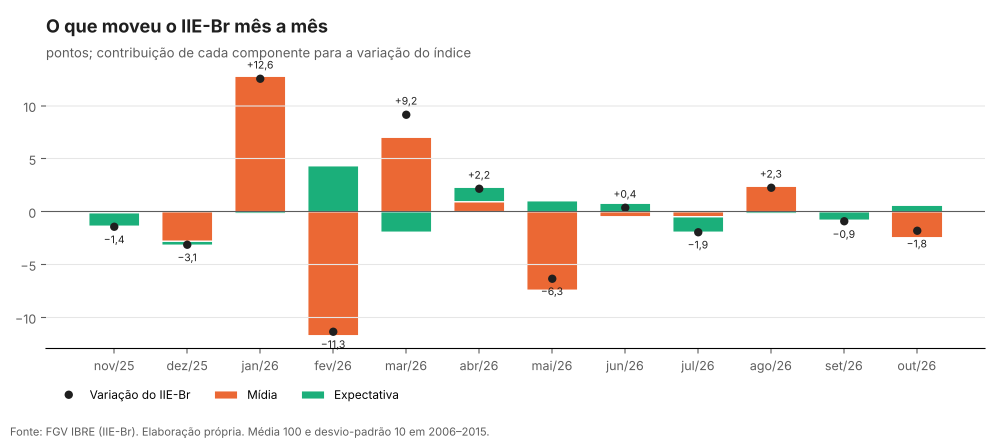
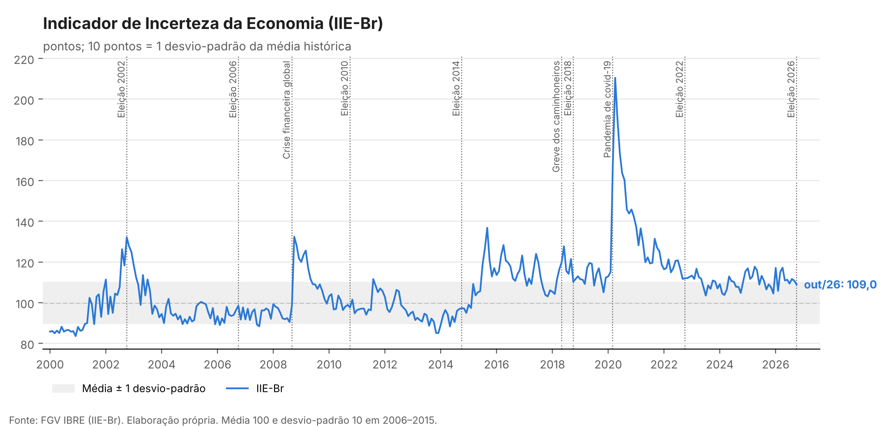

# Monitor de incerteza econômica: leitura do IIE-Br

Leitura mensal do Indicador de Incerteza da Economia (IIE-Br), do FGV IBRE: o número do mês, o componente que o moveu, os eventos que marcaram o período e um guia para interpretar o indicador na análise de conjuntura.

📄 **[Nota do último mês](nota/ultima_nota.md)**



---

## Como ler o nível do indicador

O IIE-Br é padronizado para ter **média 100 e desvio-padrão 10** no período de referência, de janeiro de 2006 a dezembro de 2015. A leitura é em desvios-padrão em relação a essa média:

| Pontos | Leitura |
|---|---|
| Abaixo de 100 | Incerteza abaixo da média histórica |
| 100 a 110 | Acima da média, a menos de 1 desvio-padrão (faixa cinza nos gráficos) |
| 110 a 120 | Entre 1 e 2 desvios-padrão acima da média: incerteza elevada |
| Acima de 120 | Mais de 2 desvios-padrão: episódios como a crise de 2008, a recessão de 2015–16 e a pandemia (pico de 210,5 em abril de 2020) |

Como o período de referência é fixo, o nível é comparável ao longo do tempo: 115 em 2026 significa o mesmo grau de incerteza relativa que 115 em 2010.

## O que cada componente mede

**IIE-Br Mídia (peso 0,8):** a frequência de notícias sobre incerteza econômica em seis jornais (Folha de S.Paulo, Valor Econômico, O Globo, O Estado de S. Paulo, Correio Braziliense e Zero Hora), nas versões impressa e online. Uma notícia conta quando traz ao mesmo tempo um termo econômico e um termo de incerteza. O componente mede **quanto a incerteza está presente no debate público**.

**IIE-Br Expectativa (peso 0,2):** a média dos coeficientes de variação das projeções do Focus, do Banco Central, para o câmbio e a Selic 12 meses à frente e para o IPCA dos próximos 12 meses. O componente mede **quanto os analistas discordam entre si** sobre o futuro da economia.

O índice combina os dois componentes, `0,8 × Mídia + 0,2 × Expectativa`, e é padronizado de novo para média 100 e desvio-padrão 10. A coleta vai do dia 26 do mês anterior ao dia 25 do mês de referência.

## Como interpretar os movimentos

| O que acontece | Leitura provável |
|---|---|
| Mídia e Expectativa sobem juntas | Choque amplo: o debate público e os analistas reagem ao mesmo tempo |
| Mídia sobe, Expectativa estável | Tema em evidência no noticiário que ainda não mudou a dispersão das projeções |
| Expectativa sobe, Mídia estável | Divergência técnica entre analistas, geralmente sobre inflação, juros ou câmbio |
| Salto pontual da Mídia seguido de queda | Evento de grande cobertura e efeito passageiro |

Três cuidados:

- **Incerteza não é pessimismo.** O indicador mede quanto se fala de incerteza e quanto as projeções divergem, não se as notícias são boas ou ruins.
- **Um mês isolado diz pouco.** A Mídia é volátil. O IBRE também divulga a média móvel de três meses, que a nota acompanha.
- **Coincidência não é causa.** Os eventos marcados nos gráficos mostram o que acontecia no período, e não o que causou cada movimento. Em 2026, eleições e a tramitação da PEC da escala 6×1 coincidem no tempo, o que impede atribuir variações a um só fator.
- **A janela de coleta define o mês.** Como a coleta vai do dia 26 ao dia 25, um evento do fim do mês pode cair no mês seguinte. Em 2002, 2006, 2010, 2014, 2018 e 2022, o segundo turno foi entre 26 e 31 de outubro e entrou no índice de novembro. Em 2026, o segundo turno foi em 25 de outubro, o último dia da coleta: o índice de outubro capta a campanha e a votação dos dois turnos, mas, como o resultado saiu na noite do dia 25, a maior parte da repercussão (jornais impressos, reação do mercado e revisões do Focus) fica para novembro.

## O que o monitor calcula

- **Contribuição de cada componente para a variação do mês.** Como o índice é repadronizado depois da ponderação, cada ponto dos componentes vale um pouco mais do que o peso nominal no índice. O fator de escala é estimado a partir da própria série, e a decomposição reproduz as contribuições divulgadas pelo IBRE.
- **Conferência da base.** Para cada mês, o índice é reconstruído a partir dos componentes. Diferenças grandes indicam erro de registro, e os meses suspeitos aparecem na nota.
- **Média móvel trimestral, faixa histórica e posição do mês na distribuição desde 2000.**





## Atualização

O IBRE divulga o IIE-Br no fim de cada mês. A cada divulgação, os valores do índice e dos componentes do press release entram em [`data/iie_br.csv`](data/iie_br.csv), e os eventos do período em [`data/eventos.csv`](data/eventos.csv). Um workflow do GitHub Actions regenera gráficos, tabelas e nota.

## Estrutura

```
├── data/
│   ├── iie_br.csv       # índice e componentes, mês a mês
│   └── eventos.csv      # eventos marcados nos gráficos
├── src/
│   ├── analise.py       # escala, contribuições, conferência e classificação
│   ├── graficos.py
│   └── main.py          # gera tudo e escreve a nota
├── tests/               # testes com série sintética construída pela metodologia do IBRE
├── output/              # figuras e tabelas
└── nota/                # nota do último mês
```

## Fonte

FGV IBRE, *Indicador de Incerteza da Economia Brasil (IIE-Br)*, press releases mensais, e *Metodologia para o cálculo do Indicador de Incerteza da Economia Brasil*, janeiro de 2021. Os valores reproduzidos aqui são os divulgados pelo IBRE.

## Autor

**Alexandre Saldanha**, economista e mestrando em População, Território e Estatísticas Públicas (ENCE/IBGE). [LinkedIn](https://www.linkedin.com/in/alexandre-saldanha-202a8592/) · [Lattes](http://lattes.cnpq.br/5148309722351266)

Código sob licença [MIT](LICENSE).
